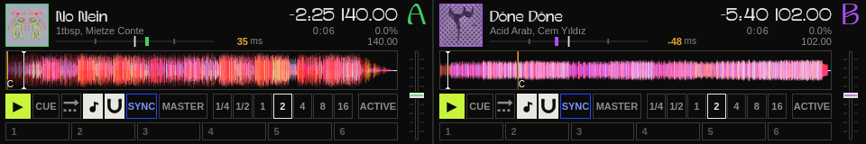
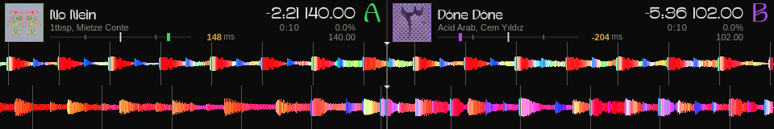
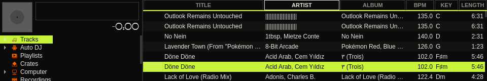
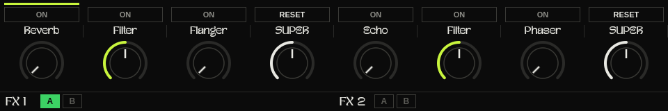
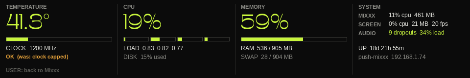
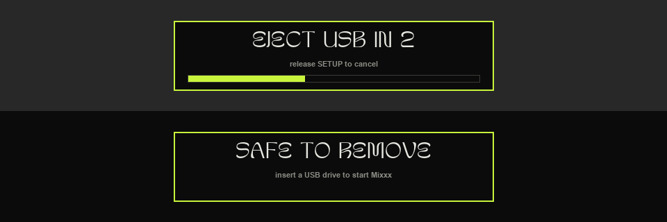

# Headless Raspberry Pi deployment

The production box: a Raspberry Pi with Mixxx running headless, an Ableton
Push 2 as the only controller *and* screen, a Native Instruments Komplete
Audio 6 as the sound card, and the music on a USB drive. The Pi runs this
repo's `commissioning` branch from `~/push-mixxx`; most pieces below are
system config on the Pi itself (not in the repo).

| Device page | Mix page |
|---|---|
|  |  |
| **Browse page** | **FX page (Clip scene)** |
|  |  |

Captured from the Pi's virtual display (what the Push 2 shows) with two decks
playing; the line under the artist is the beat-sync meter.

## How it fits together

```
Push 2 pads/buttons ──USB MIDI──▶ push2-midi-relay ──VirMIDI 7-1──▶ Mixxx (pusher.midi.xml)
Mixxx (Pusher160 skin on Xvfb :1, 960x160) ──screen capture──▶ push2-screen ──USB bulk──▶ Push 2 display
Mixxx (bridge.midi.xml) ──VirMIDI 7-0 SysEx: scene, audio dropouts──▶ push2-screen
Mixxx ──ALSA──▶ Komplete Audio 6 (deck A: out 1-2, deck B: out 3-4, external mixer)
USB drive ──auto-mount──▶ ~/Music/usb  (music + .mixxx/mixxxdb.sqlite library + Playlists/*.m3u8)
```

Services (systemd): `xvfb`, `mixxx`, `push2-screen`, `push2-midi-relay`,
`usb-library-mount@<dev>`.

## Push 2 buttons added on the Pi

| Button | Action |
|---|---|
| **User** | Pi stats page (temperature/throttling, CPU, memory, processes, audio dropouts) |
| hold **Setup** 3 s | restart Mixxx (countdown on screen, release to cancel) |
| **Shift** + hold **Setup** 3 s | eject the USB drive (Mixxx quits cleanly, saves cues; "Safe to remove") |
| **Delete** | closes any Mixxx popup window that landed on the screen |




## Behaviour worth knowing

- **Unplugging the Push is safe.** Mixxx only opens MIDI ports at startup, so
  the Push mapping is bound to the virtual port VirMIDI 7-1 and
  `screen/push2_midi_relay.py` forwards MIDI to the real Push, reopening it
  on replug. Music keeps playing; the relay then sends CC 127 on channel 16 and
  the mapping (`PUSH2T.redraw`) repaints the LEDs. The screen app reconnects
  the display on its own.
- **Any USB drive works and carries its own library** (`<drive>/.mixxx/`): BPM,
  beat grids, keys, cues and playlists travel with the drive; a new drive gets
  an empty library. Waveforms are a per-drive cache on the SD card, cleared at
  every boot. No drive = Mixxx waits, the Push shows "Insert USB drive".
- **Playlists** come from `<drive>/Playlists/*.m3u8` (written by the separate
  iTunes→USB exporter) and are mirrored into locked Mixxx playlists on each
  start (`usb/import_playlists.py`).
- **Mixxx quits cleanly on every stop** (Ctrl+Q via `mixxx-clean-quit`), so cues
  are saved; pulling the power still loses unsaved cues. Window geometry and the
  default FX (Reverb/Filter/Flanger, Echo/Filter/Phaser) are reset at each start.
- Decks start with quantize and keylock on; the library only shows the drive's
  own sections (Rekordbox, Serato, Traktor, iTunes... hidden).

## Hardware: Pi 3 limits and the Pi 4 recommendation

Developed on a **Raspberry Pi 3 Model B** (1 GB). It runs everything, but the
audio drops out. Measured with the dropout counter (2026-10-13, ~20 min of
play): **9 dropouts, 8 of them with Mixxx's audio engine under 50% load**, so
the CPU was keeping up and the audio arrived late at the sound card over USB.

Why: the Pi 3 has one USB 2.0 controller (`dwc_otg`) that is poor at real-time
audio streaming, and Ethernet, the Komplete Audio 6 and the Push 2's screen
data all share it. Already tried on the Pi 3, all helping but not fixing it:

- audio buffer 23 → 46 ms, SoundTouch keylock, waveform redraw capped at 30 FPS,
  software GL limited to one thread;
- screen capture capped at 20 FPS (30 in the Mix scene), screen app at nice 19
  with a CPU quota;
- a fan (the Pi was throttling at 82 °C; now ~45-60 °C).

**Recommended: Raspberry Pi 4, 4 GB**, official 5 V / 3 A USB-C supply (the Push
keeps its own supply), heatsink or fan. Its xHCI USB 3 controller handles audio
streams properly, Ethernet sits off the USB bus, and the CPU is ~3x faster. The
same SD card boots on it unchanged. After moving: raise the screen FPS again and
re-run the dropout counter for ~20 min to confirm. A Pi 5 would also work but
needs a 5 A supply and runs hotter; not needed for two decks + the Push.

## Pi-side files (outside the repo)

- `/usr/local/bin/`: `mixxx-prestart` (drive check, per-drive library/cache links,
  geometry + FX reset, playlist import), `mixxx-clean-quit`, `usb-library-mount`,
  `usb-library-unplugged`, `usb-library-eject`, `push2-replug` (old
  restart-on-replug fallback, its udev rule is disabled)
- `/etc/systemd/system/`: `xvfb`, `mixxx`, `push2-screen`, `push2-midi-relay`,
  `usb-library-mount@`, `push2-replug` services
- `/etc/udev/rules.d/`: `90-usb-library.rules`, `91-push2-replug.rules.disabled`
- `/etc/tmpfiles.d/mixxx-analysis.conf` (waveform cache cleared at boot),
  `/etc/modprobe.d/virmidi.conf` (VirMIDI pinned to card 7), `/etc/asound.conf`
  (Komplete Audio 6 as default by name)
- `~/.mixxx/`: `mixxx.cfg`, `soundconfig.xml`, `effects.default.xml`,
  `library-template.sqlite`; controllers and the Pusher160 skin are symlinks
  into this repo

Update the Pi: `cd ~/push-mixxx && git pull && sudo systemctl restart mixxx push2-screen push2-midi-relay`.
