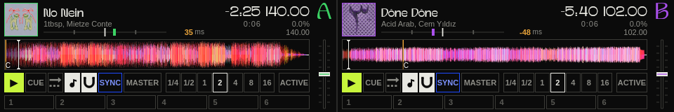
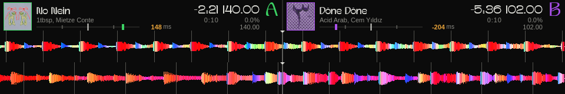
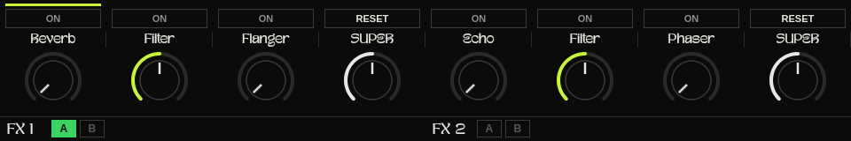
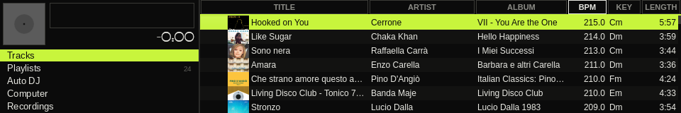
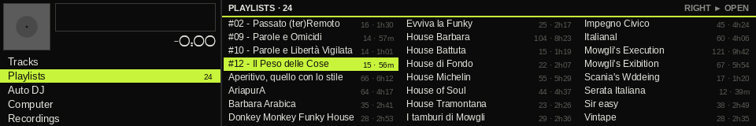
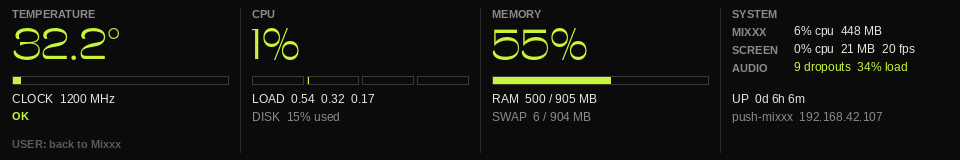
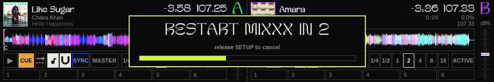
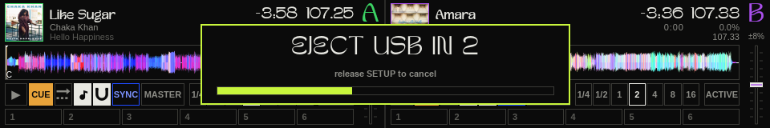

# Headless Raspberry Pi deployment

The production box: a Raspberry Pi with Mixxx running headless, an Ableton
Push 2 as the only controller *and* screen, a Native Instruments Komplete
Audio 6 as the sound card, and the music on a USB drive. The Pi runs this
repo's `commissioning` branch from `~/push-mixxx`; most pieces below are
system config on the Pi itself (not in the repo).

## Screens

Captured from the Pi's virtual display (exactly what the Push 2 shows), with a
track loaded on each deck from an exported USB drive.

**Device page** (Device scene): cover, title/artist/album, remaining time, BPM,
pitch, overview with cue marker, transport/loop row, hotcues.



**Mix page** (Mix scene): both decks' scrolling waveforms. While both decks
play, the line under each artist becomes the beat-sync meter.



**FX page** (Clip scene): the two effect units with their default chains,
Reverb/Filter/Flanger and Echo/Filter/Phaser; the lime bar marks the selected
effect (arrows or touching its encoder).



**Browse page** (Browse scene): preview deck, library nav, and the track table
with cover art, its columns lined up under the sort labels (here sorted by BPM,
descending; the selected row is lime). The nav (Tracks, Playlists, Auto DJ,
Computer, Recordings, History, Analyze) is painted by the screen app, since
Mixxx's sidebar can't be reordered or have Crates hidden; the Push script steers
Mixxx's real sidebar behind it. Left = nav, Right = into the songs; on Computer
or History, Right opens Mixxx's folder tree and Left collapses it again.



On **Playlists** the right pane lists the playlists imported from the drive's
`Playlists/*.m3u8` (track count and length after each name). Right puts a
cursor on the list (Up/Down or the browse encoder move it), Right again opens
that playlist's songs, Left goes back to the list.

Convert (on the list, or inside an open playlist) analyses that playlist in
the background: the screen app picks "Analyse entire Playlist" from Mixxx's
right-click menu on it (`screen/playlist_analysis.py`, via `xdotool` on the
Xvfb display), so nothing loads and you keep browsing. A bar at the bottom of
the Browse page shows how many of its tracks are done (counted from the stored
waveforms in the drive's library); Mixxx's Analyze view shows the same queue.

On **Auto DJ** the top buttons above the table drive Auto DJ instead of
sorting: on/off, fade now, skip next, shuffle, add a random song (their labels
replace the sort labels), and a summary of the queue (songs, total length, the
next one) replaces Mixxx's control row. DELETE with the queue focused removes
the selected song. On the other pages the 2nd top button adds the selected
songs to the queue (SHIFT: to the top).

On **Recordings** the right pane shows the recording in progress (time, size,
file) or "hold REC to start", the free space, and the recordings folder below
(newest first: name, date, length, size). Right puts a cursor on the list;
DELETE marks the file under it, DELETE again within 3 s deletes it (and its
`.cue`). The file being recorded can't be deleted. Recording starts and stops
with a 0.8 s hold on REC (the screen counts it down); a tap does nothing.



### Drawn by the screen app

These are rendered by `screen/mixxx-midi-bridge.py` on top of (or instead of) the
skin capture. The stats page shows sample numbers.

| | |
|---|---|
| **User**: Pi stats page |  |
| hold **Setup**: restart countdown |  |
| **Shift** + hold **Setup**: eject countdown |  |
| after eject |  |
| no drive plugged in |  |
| drive in, Mixxx loading |  |

## How it fits together

```
Push 2 pads/buttons ──USB MIDI──▶ push2-midi-relay ──VirMIDI 7-1──▶ Mixxx (pusher.midi.xml)
Mixxx (Pusher160 skin on Xvfb :1, 960x160) ──screen capture──▶ push2-screen ──USB bulk──▶ Push 2 display
Mixxx (bridge.midi.xml) ──VirMIDI 7-0 SysEx: scene, audio dropouts──▶ push2-screen
Mixxx ──ALSA──▶ Komplete Audio 6 (deck A: out 1-2, deck B: out 3-4, external mixer)
external mixer REC out ──▶ Komplete Audio 6 in 3-4 (rear) ──▶ Mixxx Record/Broadcast input (REC)
USB drive ──auto-mount──▶ ~/Music/usb  (music + .mixxx/mixxxdb.sqlite library + Playlists/*.m3u8)
```

Services (systemd): `xvfb`, `mixxx`, `push2-screen`, `push2-midi-relay`,
`usb-library-mount@<dev>`.

Recording takes the external mixer's output through the Komplete Audio 6's
rear inputs 3-4, set as Mixxx's Record/Broadcast input in
`~/.mixxx/soundconfig.xml` (and `soundconfig.default.xml`). Mixxx's main mix
stays enabled (`[Master] enabled 1` in `mixxx.cfg`) although nothing plays it:
with it disabled Mixxx never starts writing a recording (it waits for audio
forever, even with a Record/Broadcast input).

## Push 2 buttons added on the Pi

| Button | Action |
|---|---|
| **User** | Pi stats page (temperature/throttling, CPU, memory, processes, audio dropouts) |
| hold **Setup** 3 s | restart Mixxx (countdown on screen, release to cancel) |
| **Shift** + hold **Setup** 3 s | eject the USB drive (Mixxx quits cleanly, saves cues; "Safe to remove") |
| **Delete** | closes any Mixxx popup window that landed on the screen |

See [Screens](#screens) for what each one looks like.

## Behaviour worth knowing

- **Unplugging the Push is safe.** Mixxx only opens MIDI ports at startup, so
  the Push mapping is bound to the virtual port VirMIDI 7-1 and
  `screen/push2_midi_relay.py` forwards MIDI to the real Push, reopening it
  on replug. Music keeps playing; the relay then sends CC 127 on channel 16 and
  the mapping (`PUSH2T.redraw`) repaints the LEDs. The screen app reconnects
  the display on its own.
- **Any USB drive works and carries its own library** (`<drive>/.mixxx/`): BPM,
  beat grids, keys, cues and playlists travel with the drive; a new drive gets
  an empty library. Waveforms are a per-drive cache on the SD card, cleared at
  every boot. No drive = Mixxx waits, the Push shows "Insert USB drive".
- **Playlists** come from `<drive>/Playlists/*.m3u8` (written by the separate
  iTunes→USB exporter) and are mirrored into locked Mixxx playlists on each
  start (`usb/import_playlists.py`).
- **Mixxx quits cleanly on every stop** (Ctrl+Q via `mixxx-clean-quit`), so cues
  are saved; pulling the power still loses unsaved cues. Window geometry and the
  default FX (Reverb/Filter/Flanger, Echo/Filter/Phaser) are reset at each start.
- Decks start with quantize and keylock on; the library only shows the drive's
  own sections (Rekordbox, Serato, Traktor, iTunes... hidden).

## Hardware: Pi 3 limits and the move to a Pi 5

**Since 2026-11-19 it runs on a Raspberry Pi 5**: the Pi 3's SD card moved over
unchanged (Raspberry Pi OS trixie already carries the Pi 5 kernel). Notes:

- Ethernet 192.168.42.107; the onboard WiFi (SSID BiFi) has the fixed
  192.168.42.106 as a backup way in (route metric 600, so Ethernet stays the
  main route). The Pi 3's USB WiFi adapter is no longer used
  (`dtoverlay=disable-wifi` is commented out in `config.txt`).
- The Komplete Audio 6 and the Push sit on different USB controllers (each
  vertical pair of ports is one controller).
- ALSA card numbers move: the HDMI audio devices take two, the Push one, so
  the K6 is `hw:3,0` now (it was `hw:1,0` on the Pi 3), set in
  `soundconfig.xml` and `soundconfig.default.xml`. If Mixxx starts without the
  K6 it saves an empty `soundconfig.xml`; restore it from the default file.
- The supply is not the official 5 A one: it negotiates 3 A, which limits USB
  to 600 mA in total. Watch the stats page for undervoltage.


Developed on a **Raspberry Pi 3 Model B** (1 GB). It runs everything, but the
audio drops out. Measured with the dropout counter (2026-10-13, ~20 min of
play): **9 dropouts, 8 of them with Mixxx's audio engine under 50% load**, so
the CPU was keeping up and the audio arrived late at the sound card over USB.

Why: the Pi 3 has one USB 2.0 controller (`dwc_otg`) that is poor at real-time
audio streaming, and Ethernet, the Komplete Audio 6 and the Push 2's screen
data all share it. Already tried on the Pi 3, all helping but not fixing it:

- audio buffer 23 → 46 ms, SoundTouch keylock, waveform redraw capped at 30 FPS,
  software GL limited to one thread;
- screen capture capped at 20 FPS (30 in the Mix scene), screen app at nice 19
  with a CPU quota;
- a fan (the Pi was throttling at 82 °C; now ~45-60 °C).

**Recommended: Raspberry Pi 4, 4 GB**, official 5 V / 3 A USB-C supply (the Push
keeps its own supply), heatsink or fan. Its xHCI USB 3 controller handles audio
streams properly, Ethernet sits off the USB bus, and the CPU is ~3x faster. The
same SD card boots on it unchanged. After moving: raise the screen FPS again and
re-run the dropout counter for ~20 min to confirm. A Pi 5 would also work but
needs a 5 A supply and runs hotter; not needed for two decks + the Push.

## Pi-side files (outside the repo)

- `/usr/local/bin/`: `mixxx-prestart` (drive check, per-drive library/cache links,
  geometry + FX reset, playlist import), `mixxx-clean-quit`, `usb-library-mount`,
  `usb-library-unplugged`, `usb-library-eject`, `push2-replug` (old
  restart-on-replug fallback, its udev rule is disabled)
- `/etc/systemd/system/`: `xvfb`, `mixxx`, `push2-screen`, `push2-midi-relay`,
  `usb-library-mount@`, `push2-replug` services
- `/etc/udev/rules.d/`: `90-usb-library.rules`, `91-push2-replug.rules.disabled`
- `/etc/tmpfiles.d/mixxx-analysis.conf` (waveform cache cleared at boot),
  `/etc/modprobe.d/virmidi.conf` (VirMIDI pinned to card 7), `/etc/asound.conf`
  (Komplete Audio 6 as default by name)
- `~/.mixxx/`: `mixxx.cfg`, `soundconfig.xml`, `effects.default.xml`,
  `library-template.sqlite`; controllers and the Pusher160 skin are symlinks
  into this repo

Update the Pi: `cd ~/push-mixxx && git pull && sudo systemctl restart mixxx push2-screen push2-midi-relay`.
